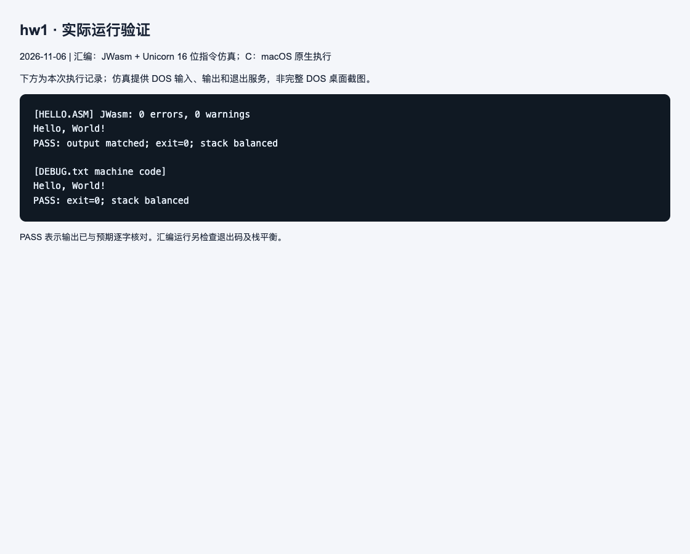

# 作业 1：汇编程序与调试入门

## 解题思路

`HELLO.ASM` 采用 SMALL 内存模型。EXE 启动时先将 `@data` 装入 DS，再通过 DS:DX 指向以 `$` 结尾的字符串。DOS 中断 `int 21h` 的 09h 功能输出字符串，4Ch 功能正常退出。13、10 分别表示回车和换行。

`DEBUG.txt` 是另一种机器码实验：在偏移 100h 放入指令，110h 放入字符串。`push cs / pop ds` 令数据段与代码段一致；`u` 反汇编、`d` 查看数据、`g=100` 执行。脚本中 110h 的写入会覆盖前一条命令末尾的填充字节，不影响程序。

## 编译与运行

在 DOS 中进入 hw1 目录：

```text
masm HELLO.ASM;
link HELLO.OBJ;
HELLO
```

也可用 `jwasm -mz HELLO.ASM` 生成 EXE。DEBUG 实验则启动 `debug` 后，按 `DEBUG.txt` 中后续命令逐行输入。用 `t` 单步执行时，可以观察 DS 初始化、字符串地址和 DOS 功能号。

## 结果与说明

两个版本均应输出 `Hello, World!` 并正常退出。本次实际验证包括 HELLO.EXE 和 DEBUG 实验对应机器码；后者直接执行所写入的字节，未运行 DEBUG 工具本身。

## 本次运行截图

下图是本次实际执行记录页面的截图，展示程序输出和自动核对结果。汇编使用 JWasm 生成 DOS EXE，再用 Unicorn 执行 16 位指令并模拟所需 DOS 服务；C 使用 macOS 原生执行。它不是完整 DOS 系统或 DOSBox 的窗口截图。测试日期：2026-11-06。



[查看完整运行日志](images/run-log.txt)
