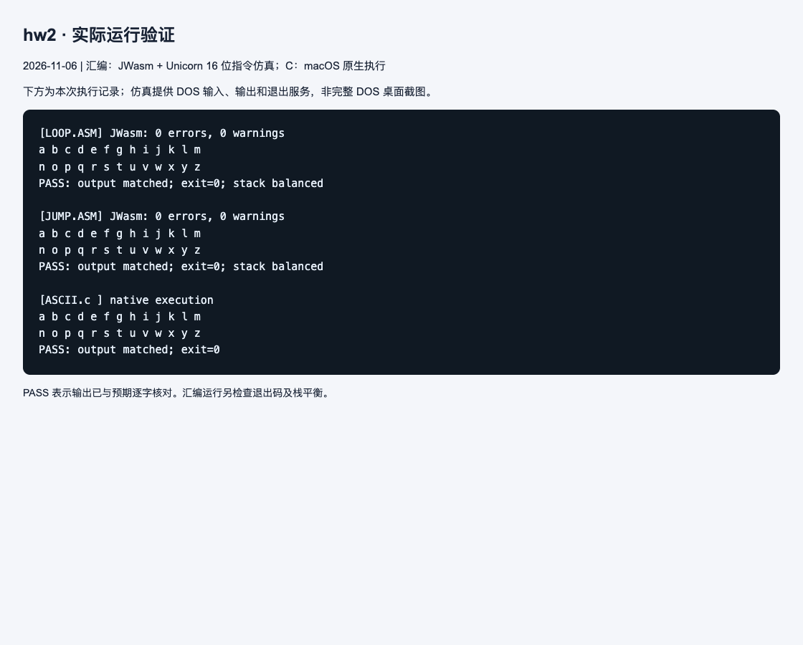

# 作业 2：循环与字符输出

## 解题思路

目标是将 a～z 分两行输出，每行 13 个字母，字母间加空格，行末不加空格。

- `LOOP.ASM` 用 BL 保存当前字母；外层控制两行，内层控制 13 列。两层 LOOP 共用 CX，进入内层前压栈保存行数，结束后恢复。
- `JUMP.ASM` 用 BH 统计当前行已输出字母数，通过 CMP 和条件跳转完成相同任务；当 BL 达到 `'z'+1` 时结束。
- `ASCII.c` 用双循环计算 `'a' + row * 13 + col`。输出前后可对照 `HOST64.txt` 中的比较、回跳和函数参数。

每个字符用 DOS 02h 功能输出；每行末尾输出回车和换行。

## 编译与运行

在 DOS 中进入 hw2 目录，分别执行：

```text
masm LOOP.ASM;
link LOOP.OBJ;
LOOP
masm JUMP.ASM;
link JUMP.OBJ;
JUMP
```

也可分别使用 `jwasm -mz LOOP.ASM` 与 `jwasm -mz JUMP.ASM`。C 版本在有 C 编译器的系统中执行：

```sh
cc -std=c11 -Wall -Wextra -O0 ASCII.c -o ascii
./ascii
```

## 结果与说明

两份汇编和 C 程序均应输出相同的两行字母。本次逐字核对了字母顺序、空格位置及换行。已有 `HOST64.txt` 标注为 Windows x86-64 的反汇编；本次 C 程序在 macOS 上重新编译运行，截图不表示重新验证了该历史反汇编的生成过程。

## 本次运行截图

下图是本次实际执行记录页面的截图，展示程序输出和自动核对结果。汇编使用 JWasm 生成 DOS EXE，再用 Unicorn 执行 16 位指令并模拟所需 DOS 服务；C 使用 macOS 原生执行。它不是完整 DOS 系统或 DOSBox 的窗口截图。测试日期：2026-11-06。



[查看完整运行日志](images/run-log.txt)
