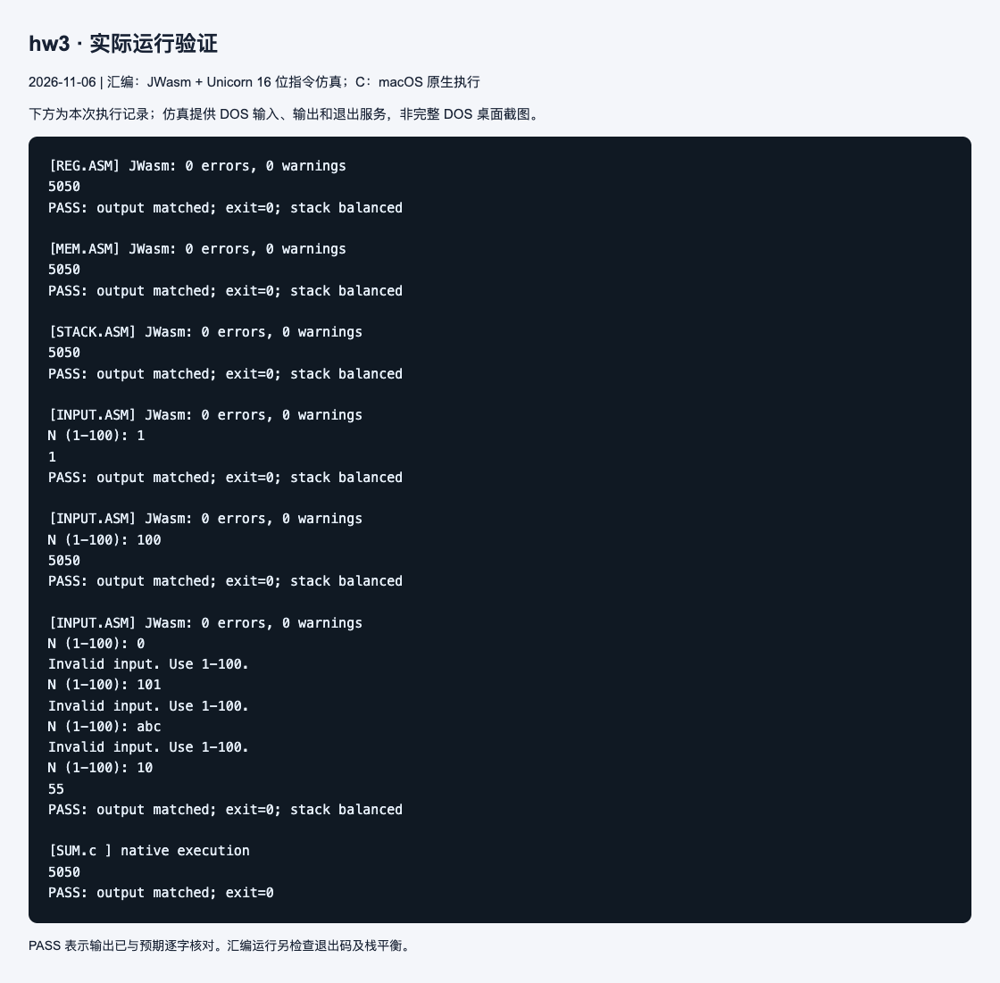

# 作业 3：累加、存储位置与输入处理

## 解题思路

1 到 100 的和为 `100 × 101 / 2 = 5050 = 13BAh`，超出 8 位无符号数范围，需要使用 16 位累加值。

- `REG.ASM`：在 AX 中直接累加，从 100 加到 1。
- `MEM.ASM`：在数据段的 `total` 字变量中累加。初始化 DS 后访问数据，小端字节顺序为 BA 13。
- `STACK.ASM`：在 SS:[BP-2] 的局部字变量中累加。BP 寻址默认使用 SS；输出前释放局部空间并恢复 BP。
- `INPUT.ASM`：用 DOS 0Ah 功能读取一行，限制长度为 1～3 位，逐位执行“原值乘 10 加当前数字”，再检查数值是否在 1～100。无效输入重新提示，合法输入执行累加。
- `PRINT.INC`：反复除以 10，将余数压栈，再逆序弹出并加 `'0'` 输出；保存并恢复所用寄存器。
- `SUM.c`：用循环完成相同累加，可结合 `HOST64.txt` 观察变量读写和加法。

## 编译与运行

在 DOS 中进入 hw3 目录；以寄存器版本为例：

```text
masm REG.ASM;
link REG.OBJ;
REG
```

将 REG 替换为 MEM、STACK 或 INPUT 即可运行其他版本。也可用 `jwasm -mz REG.ASM` 等命令生成 EXE；保持 `PRINT.INC` 位于同目录。

```sh
cc -std=c11 -Wall -Wextra -O0 SUM.c -o sum
./sum
```

## 结果与说明

三个固定累加版本和 C 版本均输出 5050。输入版分别验证 N=1、N=100，以及依次输入 0、101、abc、10：前三项被拒绝，最后输出 55。截图保留了这些实际输入及输出。

已有 `HOST64.txt` 是 Windows x86-64 反汇编材料，本次 C 程序使用 macOS 原生编译执行。

## 本次运行截图

下图是本次实际执行记录页面的截图，展示程序输出和自动核对结果。汇编使用 JWasm 生成 DOS EXE，再用 Unicorn 执行 16 位指令并模拟所需 DOS 服务；C 使用 macOS 原生执行。它不是完整 DOS 系统或 DOSBox 的窗口截图。测试日期：2026-11-06。



[查看完整运行日志](images/run-log.txt)
